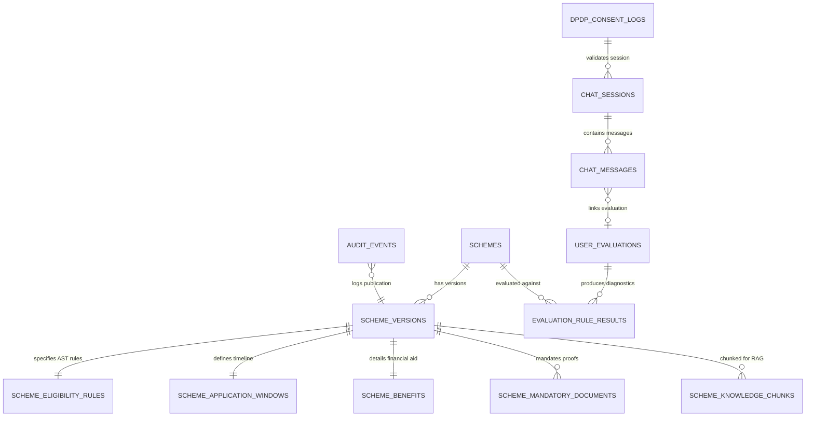

# Database Schema Architecture: SchemeSaathi

**Document Version:** 1.0.0  
**Target RDBMS:** PostgreSQL 16+ with `pgvector` Extension  
**Related DDL File:** [`database_schema.sql`](file:///D:/2026/schemesaathi/docs/architecture/database_schema.sql)  
**Status:** Milestone M0 Baseline Specification  

---

## 1. Schema Design Philosophy

The SchemeSaathi database architecture is engineered to satisfy three concurrent engineering requirements:
1. **Mathematical Determinism:** Relational integrity, foreign keys, and JSONB schemas guaranteeing that statutory rules are version-locked and auditable.
2. **Sub-150ms Hybrid RAG Retrieval:** Combining dense vector representations (`pgvector` HNSW indexes) with sparse full-text search (`tsvector` GIN indexes) inside a single transactional database, avoiding the complexity of an external vector store (e.g., Pinecone/Milvus).
3. **Stateless Privacy by Design (DPDP Act 2023):** Citizen evaluation workflows are stateless and ephemeral by default. No citizen PII or 12-digit Aadhaar numbers are persisted in any table.

---

## 2. Entity Relationship Overview

---

## 3. Deep Dive into Core Tables

### 3.1 `schemes` & `scheme_versions` (Provenance & Version Control)
- **Problem Solved:** Government scholarship guidelines change across academic sessions (e.g., income limits raised, quotas adjusted, OTR mandates introduced). If an evaluation references old rules, students face rejection.
- **Design:** The `schemes` table stores invariant identity metadata (Ministry, Department, Official Code). The `scheme_versions` table stores academic-session specific guidelines (`2024-2025`, `2025-2026`), bound to the cryptographic `content_sha256` hash of the official government PDF.
- **Constraint:** Unique constraint on `(scheme_id, version_number)` prevents silent in-place overwrite.

### 3.2 `scheme_eligibility_rules` (Deterministic AST Storage)
- **Problem Solved:** Rule evaluation must be instantaneous without scanning through PDF text.
- **Two-Tier Filtering:**
  1. *Scalar/JSONB Fast Filters:* Columns for `income_ceiling_annual_inr`, `minimum_qualifying_marks_percent`, `target_categories`, `eligible_domiciles`, and `eligible_course_levels`. These utilize PostgreSQL B-Tree and GIN indexes to discard 80% of non-matching schemes in $< 5 \text{ ms}$.
  2. *Deep AST Expression (`ast_rule_logic`):* Stored as a standardized [JSON-Logic](https://jsonlogic.com/) Abstract Syntax Tree. Handles nested Boolean statements (e.g., *“Must be (ST AND Manipur Domicile) OR (OBC AND Valley District) AND Income $\le 2.5\text{L}$”*).

### 3.3 `scheme_knowledge_chunks` (pgvector Hybrid Storage & Model Versioning)
- **Problem Solved:** RAG chunking must preserve page numbers, issuing authorities, and official URLs for verifiable citation generation, while preventing vector-space contamination during model upgrades.
- **Embedding Metadata & Versioning:**
  - `chunk_index INTEGER NOT NULL`: Deterministic sequence order of chunk within the source version.
  - `embedding_model VARCHAR(100) NOT NULL DEFAULT 'text-embedding-3-small'`: Explicit embedding model identifier.
  - `embedding_dimension INTEGER NOT NULL DEFAULT 1536`: Dimension count matching vector configuration.
  - `model_version VARCHAR(50) NOT NULL DEFAULT 'v1'`: Logical version of the embedding pipeline to prevent mixed-space vector retrieval when embedding models are upgraded.
  - `content_sha256 VARCHAR(64) NOT NULL`: SHA-256 fingerprint of chunk text for granular deduplication.
- **Vector Specification:** `embedding vector(1536)` indexed via **HNSW (Hierarchical Navigable Small World)** with `m = 16` and `ef_construction = 64`.
- **Hybrid Search Engine:**
  - Dense Cosine Distance: `embedding <=> query_vector`
  - Sparse BM25-equivalent: `to_tsvector('english', chunk_content) @@ plainto_tsquery('english', query)`
  - Combined using Reciprocal Rank Fusion (RRF) at the SQL query layer.

### 3.4 `user_evaluations` & `evaluation_rule_results` (Explainable Diagnostics)
- **Stateless Privacy:** Profile parameters (caste, income, marks) are stored only in association with an ephemeral `session_id`. No names, phone numbers, or residential street addresses are recorded.
- **Granular Line-by-Line Audit:** Every evaluation produces an `evaluation_rule_results` row for each candidate scheme, recording:
  - `passed_income_check` (Boolean)
  - `passed_category_check` (Boolean)
  - `passed_marks_check` (Boolean)
  - `missing_criteria_fields` (JSONB array: e.g. `["income_certificate_authority"]`)
  - `ineligibility_reasons` (JSONB array: e.g. `["ANNUAL_INCOME_EXCEEDED"]`)

### 3.5 `dpdp_consent_logs` & `audit_events` (Statutory Compliance)
- **DPDP Act 2023 Alignment:** Section 6 of India's Digital Personal Data Protection Act requires unambiguous, verifiable consent before processing personal data.
- **Anonymization:** Client IP addresses and User-Agents are strictly stored as **salted SHA-256 hashes**. The salt is rotated periodically, ensuring that raw IP logs cannot be reverse-engineered.
- **Tamper-Evident Hash Chaining:** Every administrative schema update generates an audit event where `current_record_hash = SHA256(prev_record_hash + payload)`, forming an immutable cryptographic audit chain.

---

## 4. Query Performance Strategy & Benchmarks

| Query Type | Primary Target Table | Index Utilized | Expected Execution Time |
| :--- | :--- | :--- | :--- |
| **Fast Scheme Pre-filter** | `scheme_eligibility_rules` | GIN on `target_categories`, `eligible_domiciles` | $\le 4 \text{ ms}$ |
| **HNSW Vector Top-K Retrieval** | `scheme_knowledge_chunks` | HNSW cosine index (`m=16`) | $\le 18 \text{ ms}$ |
| **Full Hybrid RRF Search** | `scheme_knowledge_chunks` | HNSW + `to_tsvector` GIN | $\le 35 \text{ ms}$ |
| **Complete Profile Evaluation** | `scheme_eligibility_rules` | In-memory AST evaluation across filtered subset | $\le 15 \text{ ms}$ |
| **Full Conversational History** | `chat_messages` | Composite B-Tree on `(session_id, created_at)` | $\le 3 \text{ ms}$ |

---

## 5. Database Connection Pool Configuration & Capacity Sizing

PostgreSQL connection management is critical for high-concurrency civic portal traffic. SchemeSaathi employs SQLAlchemy 2's async connection pool (`AsyncEngine`) with explicit pool limits, statement timeouts, and connection recycling.

### 5.1 Configurable Pool Parameters

| Parameter | Environment Variable | Default Value | Description |
| :--- | :--- | :--- | :--- |
| **Base Pool Size** | `DB_POOL_SIZE` | `20` | Base persistent open connections maintained per Uvicorn worker process. |
| **Max Overflow** | `DB_MAX_OVERFLOW` | `10` | Temporary burst connections opened above base pool during traffic surges. |
| **Pool Timeout** | `DB_POOL_TIMEOUT` | `30.0` (sec) | Maximum wait time for a connection to become available before raising `TimeoutError`. |
| **Pool Recycle** | `DB_POOL_RECYCLE` | `1800` (sec) | Maximum age of connection before automated recycling (prevents silent socket drops by cloud load balancers). |
| **Statement Timeout** | `DB_STATEMENT_TIMEOUT_MS` | `30000` (ms) | PostgreSQL server-side execution timeout to terminate runaway queries. |
| **Pool Pre-Ping** | *(Internal)* | `True` | Emits `SELECT 1` ping before handing connection to application to detect closed sockets. |

### 5.2 Server Connection Math & Hardware Limits

The total concurrent connections demanded from PostgreSQL is calculated as:
$$\text{Max DB Connections} = N_{\text{workers}} \times (\text{DB\_POOL\_SIZE} + \text{DB\_MAX\_OVERFLOW})$$

For the default production baseline:
- $N_{\text{workers}} = 4$ Uvicorn processes
- $\text{DB\_POOL\_SIZE} = 20$
- $\text{DB\_MAX\_OVERFLOW} = 10$
- $\text{Max Connections} = 4 \times (20 + 10) = 120\text{ connections}$

**Database Sizing Requirement:**
The PostgreSQL `postgresql.conf` setting `max_connections` MUST be configured to at least **150** (allowing 120 application connections + 30 reserved connections for migrations, background workers, and PostgreSQL superuser administration).

