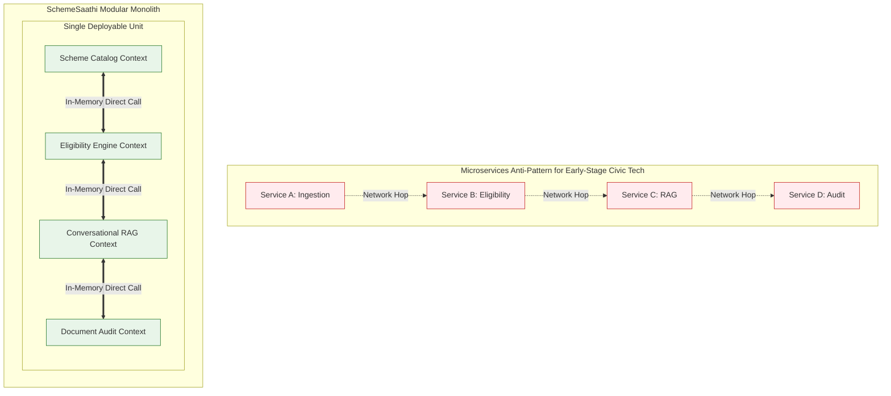
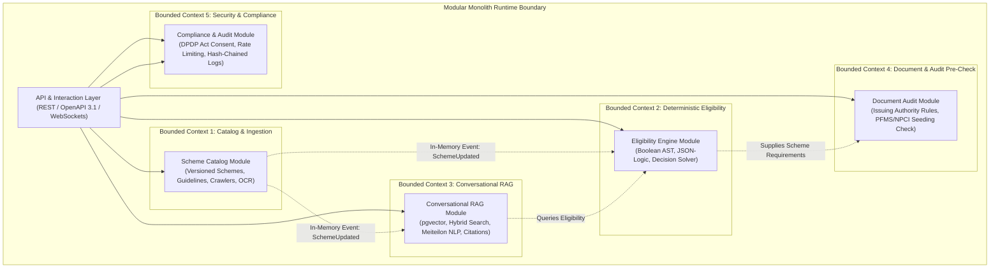
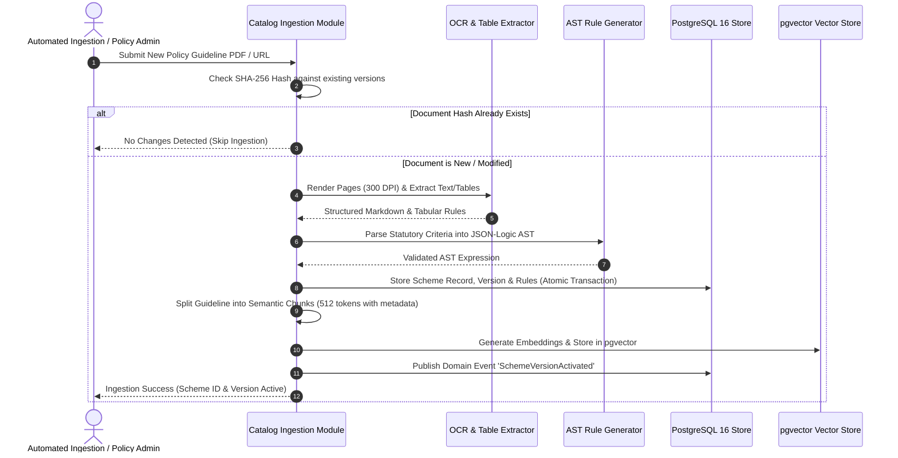
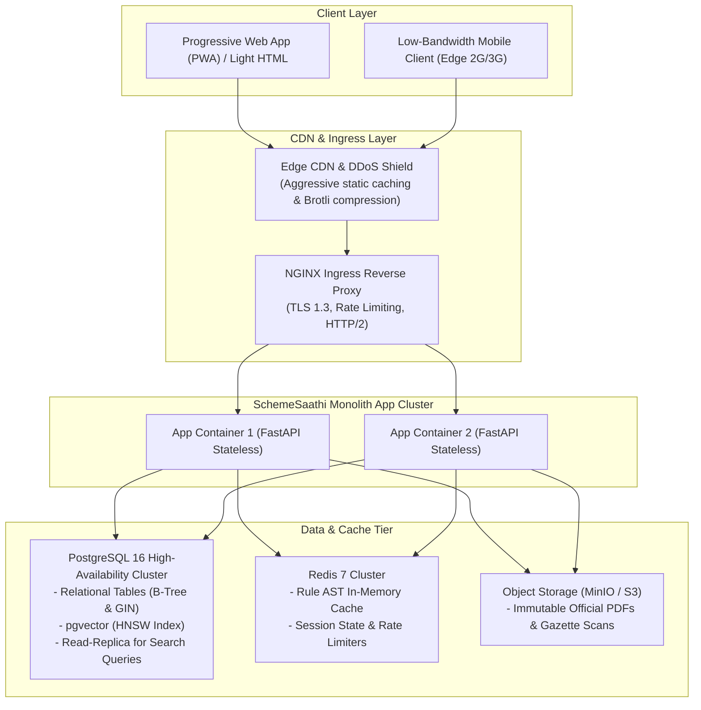
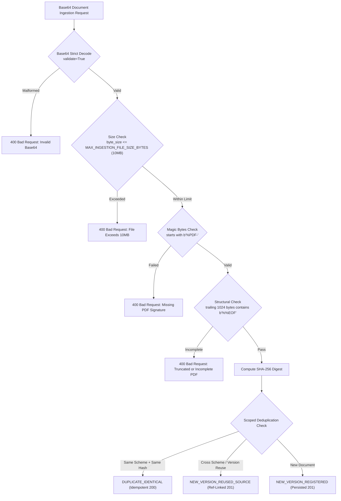

# Modular Monolith Architecture & Data Flow: SchemeSaathi

**Document Version:** 1.0.0  
**Status:** Milestone M0 Baseline Architecture  
**Architectural Style:** Domain-Driven Modular Monolith (Clean / Hexagonal Architecture per Module)  
**Target Runtime:** Containerized Linux (stateless), PostgreSQL 16 with `pgvector`, Redis 7  

---

## 1. Architectural Style Rationale: Why Modular Monolith?

A common failure in civic-tech engineering is the premature decomposition into distributed microservices. For SchemeSaathi, a **Modular Monolith** was chosen over microservices based on fundamental engineering principles:



### Strategic Benefits of the Modular Monolith:
1. **Zero Distributed Network Latency:** Evaluating 40+ schemes requires traversing complex AST rules and matching against vector embeddings. Doing this across internal HTTP/gRPC boundaries introduces 100–300ms of latency and network failure modes. In a modular monolith, evaluations execute via in-memory function calls within $\le 5\text{ ms}$.
2. **Simplified Operational Overhead:** A single containerized deployment eliminates Kubernetes orchestration overhead, service mesh management, and distributed tracing complexity, allowing small engineering teams to maintain high availability.
3. **Strict Bounded Contexts (No Spaghetti Code):** Each domain module maintains its own internal layers (Domain, Application, Infrastructure) and exposes only a typed public interface (`Facade`). Modules are strictly prohibited from querying another module's internal database tables directly.
4. **Independent Evolution & Easy Extraction:** If the Conversational RAG module requires GPU scaling in the future, its clean interface boundary permits extraction into an independent service with zero code refactoring inside the core business logic.

---

## 2. Domain-Driven Bounded Contexts (Modules)

SchemeSaathi is structured into five cohesive, decoupled bounded contexts:



### Module 1: `SchemeCatalogModule`
- **Domain Responsibilities:** Managing the lifecycle, provenance, and versions of scholarship schemes.
- **Key Entities:** `Scheme`, `SchemeVersion`, `ApplicationWindow`, `SchemeBenefit`, `RawPolicyDocument`.
- **Public Facade API:**
  - `get_active_schemes(filter: SchemeFilter) -> List[Scheme]`
  - `get_scheme_by_id(scheme_id: str, version: Optional[int]) -> SchemeDetail`
  - `ingest_policy_document(doc: RawDocument) -> IngestionResult`

### Module 2: `EligibilityEngineModule`
- **Domain Responsibilities:** Mathematical, rule-based Boolean evaluation of applicant parameters against statutory scheme rules. Zero probabilistic/LLM operations.
- **Key Entities:** `EligibilityRuleAST`, `ApplicantEvaluationContext`, `RuleEvaluationResult`, `DiagnosticClause`.
- **Public Facade API:**
  - `evaluate_profile(profile: StudentProfile, scheme_ids: Optional[List[str]]) -> EvaluationReport`
  - `validate_rule_ast(ast: Dict) -> ValidationResult`
  - `find_missing_criteria(partial_profile: StudentProfile, scheme_id: str) -> List[MissingField]`

### Module 3: `ConversationalRagModule`
- **Domain Responsibilities:** Natural language understanding, multi-turn conversation, multilingual translation/transliteration (English, Hindi, Manipuri/Meiteilon), dense-sparse hybrid retrieval, reranking, and citation generation.
- **Key Entities:** `KnowledgeChunk`, `ConversationSession`, `ChatMessage`, `CitationReference`, `GroundingScore`.
- **Public Facade API:**
  - `chat_query(session_id: str, query: str, profile: Optional[StudentProfile]) -> ChatResponseStream`
  - `search_guidelines(query: str, top_k: int) -> List[GroundedChunk]`

### Module 4: `DocumentAuditModule`
- **Domain Responsibilities:** Synthesizing personalized document checklists, issuing authority validation criteria, and PFMS/NPCI bank seeding readiness tests.
- **Key Entities:** `MandatoryDocumentRule`, `DocumentReadinessChecklist`, `IssuingAuthoritySpec`.
- **Public Facade API:**
  - `generate_checklist(evaluation_report: EvaluationReport) -> DocumentChecklist`
  - `verify_document_metadata(doc_meta: DocumentMetadata) -> DocumentAuditResult`

### Module 5: `ComplianceAndAuditModule`
- **Domain Responsibilities:** DPDP Act 2023 compliance, stateless guest execution, user consent management, IP rate limiting, and tamper-evident audit logging.
- **Key Entities:** `ConsentRecord`, `AuditEvent`, `RateLimitBucket`.
- **Public Facade API:**
  - `record_consent(consent: ConsentPayload) -> ConsentToken`
  - `log_audit_event(event: AuditEvent) -> None`
  - `check_rate_limit(client_ip: str, action: str) -> bool`

---

## 3. End-to-End Data Flow Architectures

### 3.1 Data Flow 1: Policy Ingestion, Parsing & Indexing Flow



### 3.2 Data Flow 2: Natural Query & Deterministic Evaluation Flow

```mermaid
sequenceDiagram
    autonumber
    actor Student as Student / CSC VLE
    participant Gateway as API Gateway / Rate Limiter
    participant NLP as Multilingual Router
    participant RAG as Conversational RAG Module
    participant DET as Deterministic Eligibility Engine
    participant DB as PostgreSQL 16 / pgvector
    participant DOC as Document Audit Module

    Student->>Gateway: POST /api/v1/chat/message ("Can an ST student with 72% marks get Ishan Uday in Manipur?")
    Gateway->>Gateway: Enforce IP & Session Rate Limits
    Gateway->>NLP: Route Query & Detect Language (Meiteilon / Hindi / English)
    NLP->>RAG: Standardize Query & Extract Profile Slots {Category: ST, Marks: 72%, Domicile: Manipur}
    
    par Deterministic Eligibility Check
        RAG->>DET: Evaluate Profile Slots against Active Schemes
        DET->>DB: Fetch Statutory AST Rules for candidate schemes
        DB-->>DET: JSON-Logic Rules
        DET->>DET: Execute Boolean AST Logic
        DET-->>RAG: Evaluation Result (Ishan Uday: Conditionally Eligible; Missing: Income < 4.5L, 1st Year UG)
    and Hybrid RAG Retrieval
        RAG->>DB: Hybrid Search (BM25 sparse + dense embeddings in pgvector)
        DB-->>RAG: Top-5 Grounded Chunks with Official Source URLs
        RAG->>RAG: Rerank & Cross-Score Contexts
    end

    RAG->>RAG: Synthesize Response with Strict Grounding Guardrails & Inline Citations [^1]
    RAG->>DOC: Generate Document Checklist for Eligible Candidates
    DOC-->>RAG: Formatted Checklist & Issuing Authority Warnings
    RAG-->>Gateway: Assembled Response Payload (Explanation + Diagnostic Status + Citations + Checklist)
    Gateway-->>Student: Streamed Multilingual Response
```

---

## 4. Internal Module Clean Architecture Structure

To ensure zero coupling, each bounded context adheres to Clean Architecture:

```
src/modules/{module_name}/
├── domain/                    # Pure business logic; ZERO external dependencies
│   ├── entities/              # Core business entities
│   ├── value_objects/         # Immutable value objects (e.g., Money, Percentage, AcademicYear)
│   ├── exceptions/            # Domain-specific errors (e.g., IncomeCeilingExceededException)
│   └── repositories/          # Abstract repository interfaces
├── application/               # Application orchestrations
│   ├── use_cases/             # CQRS Command and Query handlers
│   ├── dtos/                  # Request / Response Data Transfer Objects
│   └── events/                # Domain event definitions
├── infrastructure/            # Technical implementations
│   ├── persistence/           # SQLAlchemy / SQL mappings, pgvector integrations
│   ├── clients/               # OCR, embedding, or LLM clients
│   └── repositories/          # Concrete database repository implementations
└── facade/                    # Public API exposed to other internal modules
    ├── ifacade.py             # Public Interface
    └── facade_impl.py         # Concrete in-memory facade
```

---

## 5. Physical Deployment Topology & Hardware Sizing



### Production Resource Sizing (M1 Baseline):
- **App Containers:** 2 $\times$ 2 vCPU, 4GB RAM (Stateless, auto-scaling up to 8 during August peak).
- **PostgreSQL 16:** 4 vCPU, 16GB RAM, NVMe SSD storage with `pgvector` extension enabled.
- **Redis Cache:** 1 vCPU, 2GB RAM.
- **Estimated Monthly Operating Cost:** $<\$120$ USD on standard cloud infrastructure (Hetzner, AWS, or DigitalOcean), preserving public-good civic affordability.

---

## 6. Document Ingestion Guardrails & Deduplication Architecture

The Catalog Ingestion subsystem handles official scholarship guideline documents and notifications. Ingestion must defend against malformed payloads, denial-of-service, and duplicate storage while ensuring absolute data integrity.

### 6.1 Ingestion Hardening Pipeline



### 6.2 Key Ingestion Guardrails:
1. **Size Limits (`MAX_INGESTION_FILE_SIZE_BYTES`):** Configurable threshold (default `10,485,760` bytes / 10MB) protects against RAM exhaustion attacks during base64 decoding.
2. **Strict Base64 Decoding:** `base64.b64decode(..., validate=True)` immediately rejects corrupt strings or invalid padding.
3. **File Signature & EOF Integrity:** Validates both the start header (`%PDF-`) and end-of-file trailer (`%%EOF` within last 1KB) to reject truncated or corrupted uploads.
4. **Deterministic Safe Storage Boundaries:** Storage paths are isolated using content hashes: `documents/{sha256[:2]}/{sha256}.pdf`. Directory traversal attacks via file names are impossible.
5. **Scoped Deduplication Semantics:**
   - Same Scheme + Matching SHA-256: Returns `DUPLICATE_IDENTICAL` with existing version metadata.
   - Cross-Scheme Source Reuse: When multiple schemes share a central omnibus guideline document, the physical payload is deduplicated while linking a new scheme version entry (`NEW_VERSION_REUSED_SOURCE`).

