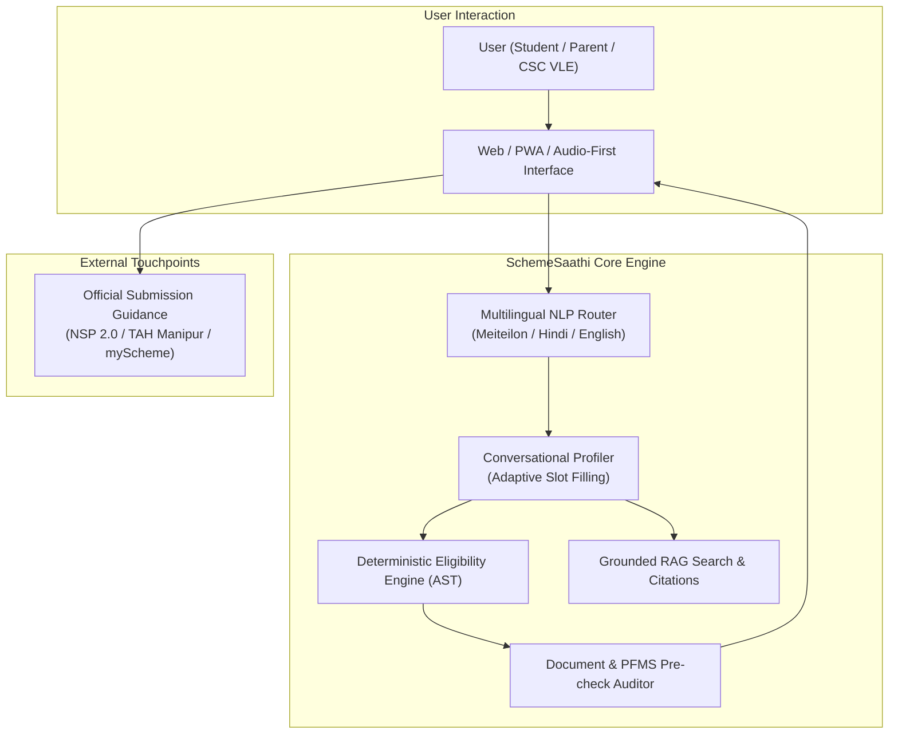

# Product Requirements Document (PRD): SchemeSaathi

**Product Name:** SchemeSaathi (स्कीम साथी / ꯁ꯭ꯀꯤꯝ ꯁꯥꯊꯤ)  
**Document Version:** 1.0.0  
**Phase:** Milestone M0 Baseline  
**Target Release:** M1 Pilot Launch (Manipur & Central Focus)  
**Document Owner:** Principal AI Engineer & Product Architect  

---

## 1. Vision & Executive Summary

### 1.1 Vision Statement
To ensure that no student in India—particularly in peripheral and conflict-affected regions like Manipur—is deprived of higher education or vocational empowerment due to information asymmetry, linguistic alienation, or bureaucratic submission barriers. SchemeSaathi serves as a trusted, zero-hallucination, multilingual scholarship discovery and eligibility copilot.

### 1.2 Core Philosophy
- **Mathematical Determinism over Generative Guesswork:** Generative AI must *never* make the final eligibility determination. All eligibility assessments are computed deterministically via an Abstract Syntax Tree (AST) rule engine grounded in statutory gazettes.
- **Explainability over Blackbox Rejection:** When a student is ineligible, SchemeSaathi clearly explains *why* in their native language and identifies alternative schemes for which they qualify.
- **Pre-Submission Failure Auditing:** SchemeSaathi acts as an intelligent pre-submission auditor, catching demographic, document, and banking configuration errors *before* the student submits an application on official government portals (e.g., NSP).

---

## 2. Target Personas & User Journeys

### Persona 1: Mary (Displaced Hill-District Student)
- **Profile:** 19 years old, belonging to the Paite (ST) community from Churachandpur, currently displaced and staying in a transitional student hostel near Imphal.
- **Academic Context:** 2nd year B.Sc. student at a Government College in Manipur.
- **Pain Points:** Parent's farming income disrupted; original college identity card misplaced during unrest; confused whether to apply for *Post-Matric ST (TAH Manipur)*, *CMCSRS (Displaced)*, or *Ishan Uday (NER)*; intermittent 3G cellular network access; speaks Meiteilon and English.
- **User Goal:** Quickly discover which emergency relief or recurring scholarships she qualifies for, know the exact document requirements, and verify if she can claim both CMCSRS and Post-Matric ST.

### Persona 2: Sanatomba (First-Generation Valley Student)
- **Profile:** 18 years old, Meitei (OBC-Meitei) resident of Thoubal district, first in family to pursue an engineering degree (B.Tech at NIT Manipur).
- **Academic Context:** Scored 84% in Class 12 (COHSEM Board). Family annual income is ₹1,80,000.
- **Pain Points:** Overwhelmed by NSP 2.0; does not understand what "OTR with Face RD" means; parents only speak Meiteilon; cyber café operator charged ₹500 and submitted an incomplete form the previous year, causing an uncorrected "Defective" status.
- **User Goal:** Use a conversational voice/text assistant in Meiteilon to verify his eligibility for *PM-USP CSSS*, *AICTE Pragati/Saksham*, and *Post-Matric OBC*, and receive a clear pre-submission checklist.

### Persona 3: Ibotombi (Common Service Centre - CSC VLE Operator)
- **Profile:** 34 years old, runs a Village Level Entrepreneur (VLE) CSC kiosk in rural Bishnupur.
- **Pain Points:** Serves 40+ rural students daily during the August–October NSP rush; spends 30 minutes per student explaining why an expired income certificate from 2023 will get rejected by the District Nodal Officer (DNO); prone to manual input errors.
- **User Goal:** A rapid, bulk-friendly eligibility diagnostic tool where he inputs a student's basic demographic profile and instantly receives an authoritative PDF dossier detailing eligible schemes, portal codes, and document validity dates.

---

## 3. Product Scope & Functional Requirements

### 3.1 Module 1: Multilingual Natural Dialogue & Search (FR-100)
- **FR-101 (Language Support):** Support English, Hindi, and Manipuri (Meiteilon) in both Bengali script (`mni-Beng`) and Romanized transliteration (`mni-Latn`).
- **FR-102 (Conversational Slot-Filling):** Dynamically extract profile attributes (caste category, annual parental income, current course level, domicile state, board exam percentage, disability status, gender) through friendly multi-turn dialogue.
- **FR-103 (Hybrid Search):** Allow freeform natural language queries (e.g., *"Are there any scholarships for Meitei OBC students studying engineering in Manipur?"* or *"ꯑꯩ ST ꯃꯆꯥꯅꯤ, ꯕꯤ.ꯇꯦꯛ ꯇꯃꯖꯔꯤ, ꯀꯔꯝꯕ ꯁ꯭ꯀꯣꯂꯔꯁꯤꯞ ꯐꯪꯒꯅꯤ?"*).
- **FR-104 (Negative Query Filtering):** Detect out-of-scope inquiries (e.g., commercial coaching discounts, general loans) and politely steer the user back to statutory government scholarships.

### 3.2 Module 2: Deterministic Eligibility Evaluation Engine (FR-200)
- **FR-201 (Absolute Mathematical Precision):** Execute an Abstract Syntax Tree (AST) evaluator against statutory criteria. No LLM generation allowed in the Boolean evaluation path.
- **FR-202 (Tiered Evaluation Output):** Categorize evaluated schemes into:
  - `ELIGIBLE_NOW`: Meets all statutory criteria AND application portal window is currently OPEN.
  - `ELIGIBLE_OFF_CYCLE`: Meets statutory criteria, but application portal window is currently CLOSED / UPCOMING.
  - `CONDITIONALLY_ELIGIBLE`: Meets category and academic criteria, but missing 1 or 2 verifications (e.g., needs income certificate below ₹2.5L).
  - `INELIGIBLE`: Strictly fails one or more statutory thresholds (e.g., income ₹5,00,000 exceeds ₹2,50,000 ceiling).
- **FR-203 (Clear Diagnostic Explanations):** For every evaluation, generate a deterministic line-by-line justification citing exact guideline clauses (e.g., *"You are ineligible for Ishan Uday because your Class 12 board was completed outside NER"*).
- **FR-204 (Concurrent Scholarship Rules):** Enforce cross-scheme exclusion logic (e.g., a student cannot receive both *Post-Matric ST* and *Ishan Uday* concurrently; engine warns user to select the higher-value award).

### 3.3 Module 3: Grounded Conversational RAG & Source Citations (FR-300)
- **FR-301 (Verifiable Document Citations):** Every synthesized sentence must link directly to the official government guideline document and page/section number (`[^1]`).
- **FR-302 (Strict Hallucination Threshold):** If context relevance or grounding confidence falls below 0.85, the model must trigger a fallback: *"This specific condition is not explicitly clarified in the official 2024–25 guideline. Please consult the State Nodal Officer."*
- **FR-303 (Temporal Window Visibility):** Distinctly flag whether a scheme is in active submission mode or purely cataloged for future cycles.

### 3.4 Module 4: Pre-Submission Document & PFMS Readiness Audit (FR-400)
- **FR-401 (Dynamic Document Checklist):** Generate a tailored checklist of required documents based on the student's evaluated profile.
- **FR-402 (Issuing Authority Verification Guide):** Explicitly instruct the student who the competent issuing authority must be (e.g., *"Income certificate must be issued by SDO / Sub-Divisional Officer, not Village Headman"*).
- **FR-403 (PFMS / NPCI Seeding Warning):** Display an interactive warning regarding bank account seeding: *"Is your bank account mapped in NPCI Aadhaar Payment Bridge (APB)? Having an account linked during KYC is not sufficient for DBT disbursement."*
- **FR-404 (Aadhaar Name Parity Check):** Prompt user to confirm if the name on their school admit card matches their Aadhaar card letter-for-letter, preventing e-KYC OTR failure.

---

## 4. Non-Functional Requirements (NFRs)

| NFR ID | Attribute | Target Metric / Benchmark | Justification |
| :--- | :--- | :--- | :--- |
| **NFR-01** | **Eligibility Engine Latency** | $\le 150 \text{ ms}$ (p95) for full evaluation across 50+ schemes | Real-time responsiveness during conversational slot filling. |
| **NFR-02** | **End-to-End Chatbot Latency** | First token $\le 800 \text{ ms}$; Complete stream $\le 2.5 \text{ s}$ (p90) | Maintains fluid dialogue over mobile connections. |
| **NFR-03** | **Low-Bandwidth Budget** | Initial HTML/CSS payload $\le 120 \text{ KB}$; Zero heavy SPA bloat | Rural Manipur 2G/3G edge cellular compatibility. |
| **NFR-04** | **Availability & Uptime** | $99.9\%$ during peak submission window (July–November) | High concurrency during portal closing dates. |
| **NFR-05** | **Zero False Positives (Eligibility)**| $0.00\%$ tolerance for statutory violations (Income/Caste/Marks) | Hallucinated eligibility leads to student distress and wasted application fees. |
| **NFR-06** | **RAG Faithfulness / Groundedness**| $\ge 0.95$ score on TruLens / Ragas benchmark | Absolute fidelity to official government circulars. |
| **NFR-07** | **Data Minimization & Ephemeral Mode**| Stateless guest evaluations supported; zero PII persistence | Strict compliance with Digital Personal Data Protection Act 2023. |
| **NFR-08** | **Zero Aadhaar Tokenization** | Never request, store, or transmit full 12-digit Aadhaar numbers | Mandatory compliance with Aadhaar Act and UIDAI circulars. |

---

## 5. User Stories & Acceptance Criteria

### Story US-01: Conversational Profile Discovery
> **As a** Manipuri high-school graduate living in Kangpokpi,  
> **I want to** state my marks, tribe, and family income in Meiteilon via text or voice,  
> **So that** I know exactly which government scholarships I can apply for without reading complex 50-page English gazettes.

**Acceptance Criteria:**
1. The assistant responds in conversational Meiteilon (Bengali script or Romanized script based on user input).
2. The assistant extracts: Category (`ST`), Income (`< 2.5L`), Marks (`74%`), Board (`COHSEM`), Domicile (`Manipur`).
3. The response lists *Post-Matric ST Manipur*, *Ishan Uday (NER)*, and *NEC Merit Scholarship* with clear benefit amounts.

### Story US-02: Deterministic Ineligibility Explanation
> **As an** undergraduate general category student with family income of ₹5,50,000,  
> **I want to** understand why I do not qualify for the *State Merit Scholarship Manipur*,  
> **So that** I don't waste time and money applying at a cyber café.

**Acceptance Criteria:**
1. Engine evaluates statutory income rule ($\text{income} \le 4,50,000$).
2. Evaluation fails with diagnostic code `ERR_INCOME_CEILING_EXCEEDED`.
3. Output explicitly states: *"You are not eligible for State Merit Scholarship Manipur because your family income (₹5.5L) exceeds the statutory limit of ₹4.5L per annum under DUHE guidelines."*
4. Engine checks if student is eligible for alternative schemes (e.g., *NEC Merit Scholarship* with ₹8.0L income limit).

### Story US-03: Pre-Submission Document Readiness Checklist
> **As a** CSC VLE operator assisting a rural applicant for *PM-YASASVI Post-Matric OBC*,  
> **I want to** generate a downloadable pre-submission readiness checklist,  
> **So that** the student knows which exact revenue officers to visit before the portal closes.

**Acceptance Criteria:**
1. System outputs an authoritative checklist detailing:
   - Valid OBC certificate with non-creamy layer verification.
   - Income certificate issued by SDO/Revenue Officer dated after April 1st of current fiscal year.
   - Active Bank Passbook seeded with Aadhaar and mapped in NPCI mapper.
   - 14-digit NSP OTR reference number generated via Aadhaar Face RD.
