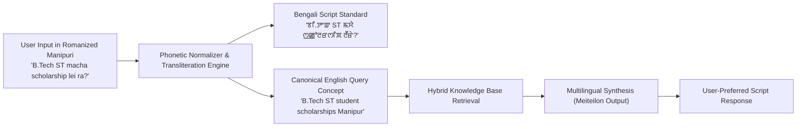

# Multilingual Conversational RAG Architecture: SchemeSaathi

**Document Version:** 1.0.0  
**Status:** Milestone M0 Baseline Specification  
**Component:** `ConversationalRagModule` (Cognitive & Grounding Layer)  
**Target Languages:** English, Hindi, Manipuri (Meiteilon in Bengali Script, Meitei Mayek, and Romanized Transliteration)  

---

## 1. Architectural Overview & RAG Philosophy

Government scholarship guidelines are legal, bureaucratic documents characterized by dense administrative jargon, nested exclusion clauses, multi-tier tabular maintenance allowances, and temporal amendments. 

Standard, off-the-shelf RAG pipelines fail critically on this corpus because:
1. **Naive Chunking Splits Tables:** Arbitrary 500-character chunks cut across course-level fee reimbursement tables, leaving the LLM unaware of which allowance maps to which group.
2. **Vocabulary Mismatch in Vernacular Languages:** A Manipuri student asking about *"ST ꯁ꯭ꯀꯣꯂꯔꯁꯤꯞ"* will fail to match English text like *"Centrally Sponsored Post Matric Scholarship for Scheduled Tribes"* unless cross-lingual embeddings and transliteration routers are utilized.
3. **Hallucination Risk:** Generative models tend to synthesize plausible-sounding dates or eligibility rules when context is ambiguous.

**SchemeSaathi's RAG Architecture addresses these via a multi-stage grounded pipeline:**

```mermaid
flowchart TD
    UserQuery["User Input (Voice / Text in Manipuri / Hindi / English)"] --> LangDetect["Multilingual Language & Script Router"]
    
    subgraph Pre-Retrieval
        LangDetect --> Translit["Transliteration & Canonical Token Extractor<br/>(Meitei Mayek ↔ Bengali Script ↔ Romanized)"]
        Translit --> QueryExp["Domain Acronym Expansion<br/>(e.g., 'OTR' → 'One Time Registration Aadhaar Face RD')"]
    end

    subgraph Hybrid Retrieval Tier (PostgreSQL 16)
        QueryExp --> Sparse["Sparse BM25 Search<br/>(GIN tsvector on keywords & acronyms)"]
        QueryExp --> Dense["Dense Vector Search<br/>(pgvector HNSW Cosine Distance)"]
        Sparse & Dense --> RRF["Reciprocal Rank Fusion (RRF)<br/>Top-20 Combined Candidates"]
    end

    subgraph Post-Retrieval & Guardrail Filter
        RRF --> Rerank["Cross-Encoder Reranker<br/>(Top-5 High-Precision Context Chunks)"]
        Rerank --> DetSync["Deterministic State Synchronizer<br/>(Injects Deterministic AST Eligibility Constraints)"]
    end

    subgraph Grounded Synthesis
        DetSync --> LLM["Grounded Response Synthesizer<br/>(System Prompts with Strict Negative Constraints)"]
        LLM --> CiteGen["Verifiable Citation Engine<br/>(Injects [^1] links to Official Government PDFs)"]
    end

    CiteGen --> FinalOut["Multilingual Response Stream"]
```

---

## 2. Document Parsing & Hierarchical Chunking Strategy

Government circulars are not narrative prose; they are structured legal instruments. SchemeSaathi implements **Hierarchical Document Chunking**:

```
Document: MoTA Post-Matric ST Guidelines 2024-2025.pdf
│
├── Level 1: Document Root Metadata (SHA-256, Ministry, Academic Year)
│
├── Level 2: Section (e.g., "Clause 4: Group-wise Maintenance Allowance")
│   │
│   ├── Level 3: Semantic Chunk 1 (Context Header + Prose Rules)
│   │   └── Text: "[Header: MoTA CSS ST | Sec 4] Eligibility conditions for Day Scholars..."
│   │
│   └── Level 3: Semantic Chunk 2 (Markdown Table Preserved Intact)
│       └── Text: "[Header: MoTA CSS ST | Sec 4] 
│                  | Group | Hosteller (INR/yr) | Day Scholar (INR/yr) |
│                  | Group 1 (Degree/Eng/Med) | 13,500 | 7,000 |
│                  | Group 2 (Pharmacy/Nursing) | 9,500 | 6,500 |"
```

### Chunking Rules:
1. **Zero Table Fracturing:** Tables containing allowance slabs, income thresholds, or institute categories are parsed into Markdown format and stored as single, non-splittable chunks.
2. **Context Enrichment (Chunk Prefixing):** Every chunk is prepended with its hierarchical lineage: `[Scheme: Post-Matric ST Manipur | Section: 3.2 Income Ceiling | Academic Year: 2024-2025]`. This prevents retrieval ambiguity when multiple schemes use identical section titles.
3. **Chunk Boundary:** Chunk size is fixed at **512 tokens with 64-token sliding window overlap** using domain-aware sentence boundaries.

---

## 3. Hybrid Retrieval: Combining Dense and Sparse Representations

### 3.1 Sparse BM25 / PostgreSQL `tsvector` Retrieval
Specialized Indian governance acronyms (e.g., `COHSEM`, `BSEM`, `AISHE`, `U-DISE`, `OTR`, `FaceRD`, `NPCI`, `CMCSRS`, `CMST`, `WARB`) carry high semantic discrimination. Dense embeddings frequently dilute acronym significance.
- **Implementation:** PostgreSQL `to_tsvector('english', chunk_content)` with a customized dictionary including North Eastern institutional terms.

### 3.2 Dense Embedding Retrieval (`pgvector`)
- **Embedding Model:** BAAI/bge-m3 or multilingual text-embedding-3-small (1536 dimensions).
- **Index:** HNSW on `pgvector` with cosine distance metric (`vector_cosine_ops`), providing $\le 18\text{ ms}$ retrieval latency across 50,000 chunks.

### 3.3 Reciprocal Rank Fusion (RRF)
RRF merges the ranked lists from sparse and dense retrieval without requiring normalized score calibration:

$$RRF\_Score(d \in D) = \frac{1}{60 + r_{sparse}(d)} + \frac{1}{60 + r_{dense}(d)}$$

The top 20 candidates from RRF proceed to cross-encoder reranking.

---

## 4. Cross-Encoder Reranking & Deterministic Synchronizer

### 4.1 Cross-Encoder Reranking
A lightweight cross-encoder model (e.g., `bge-reranker-large`) scores the $(query, chunk)$ pairs directly, reducing the 20 candidates to the **top 5 most relevant context chunks**.

### 4.2 The Deterministic State Synchronizer (Zero Hallucination Guardrail)
Before the retrieved context is passed to the LLM for final generation, the **Deterministic State Synchronizer** injects the mathematical truth computed by the `EligibilityEngineModule`:

```
SYSTEM INJECTION:
The applicant's profile has been deterministically evaluated by the statutory rule engine:
- Applicant: ST, Manipur Domicile, Family Income: INR 2,20,000, Course: B.Tech Year 1.
- Scheme Evaluated: Ishan Uday Special Scholarship (SCH-NER-012)
- Engine Outcome: CONDITIONALLY_ELIGIBLE
- Passed Checks: Category, Domicile, Income (2.2L <= 4.5L), Course (UG Year 1).
- Missing Required Verification: Needs proof of passing Class 12 from a school within NER.

CRITICAL INSTRUCTION:
You MUST NOT claim the user is fully eligible or ineligible. You MUST inform them that they 
qualify financially and academically, but must confirm their Class 12 schooling was in NER.
```

---

## 5. Multilingual NLP Strategy for Manipuri (Meiteilon)

Manipuri (Meiteilon), a Scheduled VIII language of India, presents unique computational challenges:
1. **Dual Script Usage:** Written in **Bengali script** (`mni-Beng`) historically and officially in modern **Meetei Mayek** (`mni-Mtei`).
2. **Informal Romanized Chat:** Over 80% of young students type in Romanized phonetic script (`mni-Latn`), e.g., *"Ei ST machani, scholarship ama fanggani koidana khangningi"*.



### Transliteration & Normalization Pipeline:
- **Rule-Based Mapping:** Deterministic trie-based phonetic transliteration mapping between Romanized Meiteilon, Bengali script, and Meetei Mayek.
- **Cross-Lingual Information Retrieval (CLIR):** For retrieval, the query concept is translated to English to maximize recall against canonical English government gazettes.
- **Localized Answer Synthesis:** The LLM receives the English statutory chunk and generates the explanation in the student's input script.

---

## 6. Verifiable Citation & Hallucination Guardrails

### 6.1 Inline Verifiable Citations
Every generated factual sentence must conclude with an anchor citation `[^n]` mapped to verified metadata:
```markdown
Under the Ministry of Tribal Affairs guidelines, eligible ST scholars in Group 1 courses 
(such as B.Tech or MBBS) receive a hosteller maintenance allowance of ₹13,500 per annum[^1].

[^1]: Ministry of Tribal Affairs Post-Matric ST Operational Guidelines 2024-25, Section 4.1, Page 8. 
Official Source: https://tribal.nic.in/postmatric.pdf (Retrieved: Nov 2026, SHA-256: 4f8b9...)
```

### 6.2 Strict Hallucination Fallback Protocol
If the cosine similarity score of the top-1 retrieved chunk falls below **0.78**, or if the cross-encoder relevance score is below **0.60**, the model is strictly constrained to output:
> *"The official guidelines do not explicitly clarify this specific condition for your case. To avoid application rejection, please consult your Institute Nodal Officer (INO) or the State Nodal Officer at the Directorate of Tribal Affairs & Hills, Imphal."*
