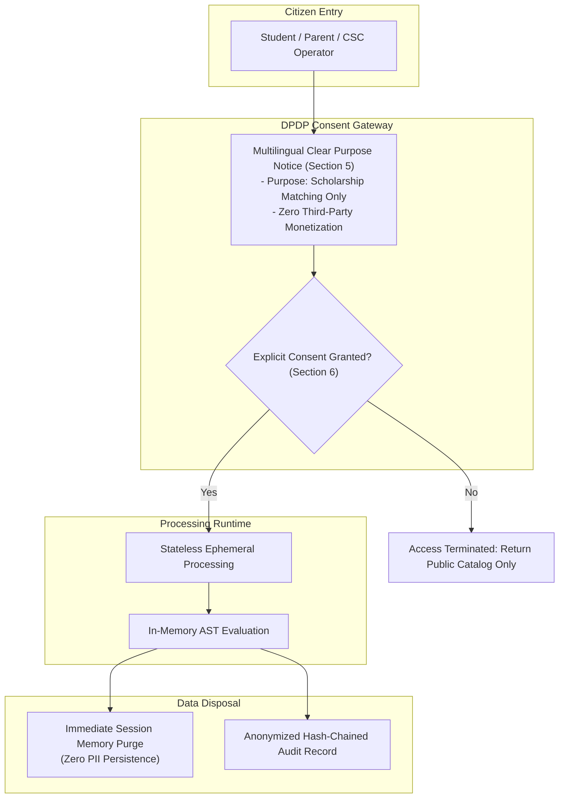
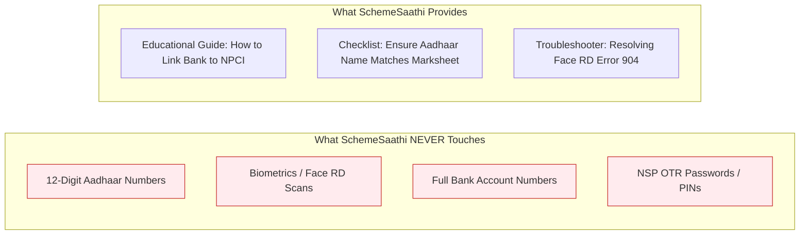
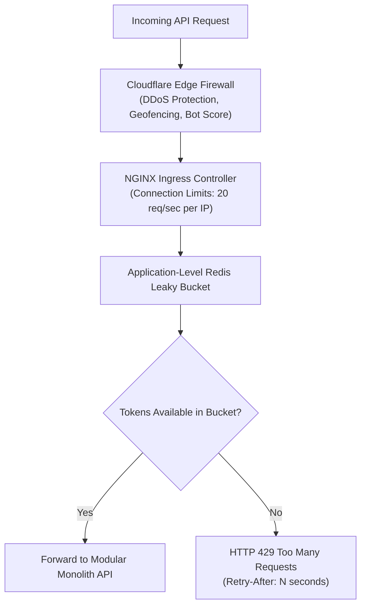

# Security, Privacy & Compliance Architecture: SchemeSaathi

**Document Version:** 1.0.0  
**Status:** Milestone M0 Baseline Specification  
**Statutory Frameworks:**  
- Digital Personal Data Protection Act 2023 (DPDP Act 2023)  
- Information Technology Act 2000 (and 2021 Intermediary Guidelines)  
- Aadhaar (Targeted Delivery of Financial and Other Subsidies, Benefits and Services) Act 2016  

---

## 1. Compliance with the Digital Personal Data Protection Act 2023 (DPDP)

SchemeSaathi processes student socio-economic and educational attributes (caste, income, marks, disability). Under DPDP Act 2023, these constitute sensitive personal data requiring strict technical safeguards:



### 1.1 Core DPDP Principles Implemented

1. **Purpose Limitation (Section 5):**  
   Data provided by the user is used **exclusively** for computing scholarship eligibility and generating document readiness checklists. It is never sold, shared with commercial loan aggregators, or utilized for profiling.
2. **Data Minimization (Section 6):**  
   The platform requests only the minimum attributes necessary to evaluate active statutory rules. It never asks for home street addresses, parent phone numbers, school registration numbers, or bank account numbers.
3. **Right to Withdraw Consent & Erasure (Section 12):**  
   Users operating in logged-in mode can trigger instantaneous deletion of their session history and profile snapshots via a single `DELETE /api/v1/user/session` call.

---

## 2. Zero-Aadhaar Storage & Banking Credential Policy

One of the largest vulnerabilities in Indian educational platforms is the unlawful collection of Aadhaar numbers and bank credentials. SchemeSaathi establishes an **Absolute Zero-Storage Policy**:



### Mandatory Security Invariants:
1. **Never Solicit Raw Identifiers:** The UI and chatbot system prompts strictly forbid asking for, accepting, or storing 12-digit Aadhaar numbers or Virtual IDs (VIDs).
2. **Automated Redaction Filter (Verhoeff Heuristic Safeguard):**
   - An in-flight regex filter (`\b\d{4}[ -]?\d{4}[ -]?\d{4}\b`) scans user input, URLs, logs, and exceptions.
   - Any 12-digit sequence passing the Verhoeff dihedral-group ($D_5$) checksum is scrubbed and replaced with `[REDACTED_AADHAAR]`.
   - **Crucial Security Distinction (Heuristic Checksum vs Authenticity):**  
     Passing Verhoeff validation **DOES NOT** prove Aadhaar authenticity or government issuance. Genuine Aadhaar authentication requires statutory UIDAI biometric or OTP protocols under the Aadhaar Act 2016. In SchemeSaathi, Verhoeff functions strictly as a *defensive mathematical heuristic* to suppress false positives on arbitrary 12-digit timestamps or serial numbers while catching prospective Aadhaar patterns before persistence or logging.
3. **Multi-Surface PII Scrubbing:**
   - **Structured JSON Logging:** `JSONFormatter` intercepts `record.getMessage()`, `record.extra`, and exception tracebacks (`formatException`) through recursive sanitization.
   - **HTTP Access Logs & URLs:** Request URL paths and query parameters are redacted before being emitted to stdout.
   - **Centralized Error Responses:** API exception details returned to clients via `build_error_response()` are sanitized against Aadhaar leakage.
4. **Request ID Validation & Header Injection Defense:**
   - Client-provided `X-Request-ID` headers are validated against `^[a-zA-Z0-9_\-]{8,64}$`.
   - Malformed, oversized, or CRLF-injected IDs are discarded, and an RFC 4122 UUIDv4 is generated server-side.
5. **No Direct Banking Interfacing:** SchemeSaathi provides explanatory guidance on how students can check their NPCI seeding status via the official UIDAI portal (`resident.uidai.gov.in`) or their bank’s USSD code (`*99*99*1#`). SchemeSaathi never requests IFSC or account credentials.

---

## 3. Cryptographic Standards & Transport Security

### 3.1 Transport Layer Security
- **Protocol:** TLS 1.3 strictly enforced; TLS 1.0, 1.1, and 1.2 deprecated.
- **HSTS:** `Strict-Transport-Security: max-age=63072000; includeSubDomains; preload` header enabled.
- **Cipher Suites:** Only forward-secret ciphers permitted (`TLS_AES_256_GCM_SHA384`, `TLS_CHACHA20_POLY1305_SHA256`).

### 3.2 Data at Rest Encryption
- **Database Storage:** Full database volume encryption via LUKS AES-256.
- **Database Fields:** Sensitive configuration parameters and admin credentials encrypted at the column level via PostgreSQL `pgcrypto` (`pgp_sym_encrypt`).
- **Object Storage:** Server-Side Encryption (SSE-S3 / AES-256) enabled for all cached government PDF guidelines.

---

## 4. Role-Based Access Control (RBAC)

The platform enforces strict role separation across three tiers:

| Role Name | Scope of Permissions | Authentication Mechanism | Audit Level |
| :--- | :--- | :--- | :--- |
| `PUBLIC_CITIZEN` | Read-only access to scheme catalog, deterministic eligibility evaluation, and conversational RAG chat. | Ephemeral JWT session token or anonymous guest session. | Rate-limited; anonymized IP hash recorded. |
| `POLICY_REVIEWER` | Create/edit scheme drafts, upload PDF guidelines, trigger OCR pipelines, view provisional AST rules. | Multi-Factor Authentication (MFA) via TOTP; OAuth 2.0 / OIDC. | Full audit logging of all draft edits. |
| `SYSTEM_ADMIN` | Activate/publish verified scheme versions, modify rate-limiting thresholds, inspect cryptographic audit logs. | Hardware security key (FIDO2 / WebAuthn) + IP allowlisting. | Immutable tamper-evident hash-chained audit logging. |

---

## 5. Rate Limiting & Denial-of-Service (DoS) Mitigation

To ensure high availability during peak portal deadlines (August–October) and prevent bot scraping:



### Rate Limiting Policies:
- `/api/v1/chat/message`: Maximum **15 requests per minute** per session/IP.
- `/api/v1/evaluation/evaluate`: Maximum **30 evaluations per minute** per session/IP (allows CSC operators to test family profiles).
- `/api/v1/schemes/catalog`: Cached at Cloudflare edge with a 1-hour TTL; bypasses application tier.

---

## 6. Tamper-Evident Cryptographic Audit Logging

To guarantee legal auditability and prevent unauthorized tampering with statutory rules, all administrative operations generate a cryptographically chained audit record in the `audit_events` table:

$$\text{Record\_Hash}_n = \text{SHA256}(\text{Record\_Hash}_{n-1} \parallel \text{Timestamp} \parallel \text{Performer\_ID} \parallel \text{Action\_Details})$$

```
Audit Chain Example:
[Block 101]
├── Timestamp: 2026-11-04T10:15:00Z
├── Performer: usr_admin_01
├── Action: PUBLISH_SCHEME_VERSION (SCH-MN-005, v3)
├── Prev_Hash: a7f8e3...
└── Curr_Hash: 9b2d41... (SHA-256)
     │
     └── Links to [Block 102]
          ├── Timestamp: 2026-11-04T11:20:00Z
          ├── Action: UPDATE_AST_RULE (SCH-NER-012)
          ├── Prev_Hash: 9b2d41...
          └── Curr_Hash: e5c189...
```

Any retrospective modification of historical rules or verification statuses breaks the hash chain, immediately raising an alert during automated integrity checks.
