# Evaluation Strategy & Benchmarking Framework: SchemeSaathi

**Document Version:** 1.0.0  
**Status:** Milestone M0 Baseline Specification  
**Focus:** Dual Evaluation Framework for Deterministic AST Engine & Multilingual RAG Pipeline  
**Standards:** RAG Triad (Context Relevance, Groundedness, Answer Relevance), Confusion Matrix Analysis, Latency Throttling  

---

## 1. Dual-Track Evaluation Philosophy

Because SchemeSaathi couples a mathematical deterministic engine with a generative multilingual assistant, evaluation must run along two distinct tracks:

```mermaid
flowchart TD
    subgraph Track A: Deterministic Eligibility Engine (Exact Metric)
        T_AST["AST Engine Test Suite"] --> P_REC["Precision, Recall & Specificity"]
        T_AST --> BOUND["Boundary Value Edge Cases (e.g. ₹2,50,000 ± ₹1)"]
        T_AST --> ZERO["Zero False-Positive Invariant (0.00% Tolerance)"]
    end

    subgraph Track B: Conversational Multilingual RAG (Cognitive Metric)
        T_RAG["RAG Benchmark Suite"] --> TRIAD["RAG Triad (TruLens / Ragas)"]
        TRIAD --> CR["Context Relevance (>= 0.85)"]
        TRIAD --> GF["Groundedness / Faithfulness (>= 0.95)"]
        TRIAD --> AR["Answer Relevance (>= 0.90)"]
        T_RAG --> LANG["Multilingual Translation Fidelity (ChrF++ / BLEU)"]
    end

    subgraph Track C: Real-World Network & Latency Benchmarks
        T_NET["Network Simulation Suite"] --> EDGE["Throttled 2G/3G Profile (Manipur Hill Simulation)"]
        T_NET --> LAT["End-to-End Latency & Payload Budget Checks"]
    end
```

---

## 2. Track A: Deterministic Eligibility Engine Evaluation

### 2.1 Benchmark Invariant: Zero False Positives
In commercial e-commerce recommenders, false positives are acceptable. In statutory welfare distribution, a **false positive** (falsely telling an ineligible student they qualify) leads to:
- Spent application fees and cyber café costs.
- Defective form return by Institutional Nodal Officers (INOs).
- Potential legal debarment for fraudulent declaration.

$$\text{Acceptance Criteria: } \mathbf{False\ Positive\ Rate\ (FPR) = 0.00\%}$$

### 2.2 Boundary Value & Equivalence Partitioning Test Matrix
The test suite subjects the AST engine to automated boundary conditions:

| Rule Evaluated | Boundary Test Condition | Expected Deterministic Output | Failure Mode Caught |
| :--- | :--- | :--- | :--- |
| **Post-Matric ST Income Ceiling** (₹2,50,000) | Income = ₹2,49,999.00 | `PASSED_INCOME_CHECK = true` | False negative truncation |
| **Post-Matric ST Income Ceiling** (₹2,50,000) | Income = ₹2,50,000.00 | `PASSED_INCOME_CHECK = true` | Off-by-one boundary failure |
| **Post-Matric ST Income Ceiling** (₹2,50,000) | Income = ₹2,50,001.00 | `PASSED_INCOME_CHECK = false` | **False positive leak** |
| **Ishan Uday (NER Schooling)** | Domicile = Manipur, School = Delhi | `PASSED_SCHOOLING = false` | Domicile vs Schooling confusion |
| **Ishan Uday (NER Schooling)** | Domicile = Manipur, School = Imphal, UG = Delhi | `PASSED_SCHOOLING = true` | Out-of-state college disqualification |
| **AICTE Pragati (Girl Student)** | Gender = Male, Income = ₹1.5L | `PASSED_GENDER = false` | Gender restriction bypass |
| **NMMSS (Class 7 Marks)** | Category = General, Marks = 54.9% | `PASSED_MARKS = false` | General cutoff relaxation error |
| **NMMSS (Class 7 Marks)** | Category = ST, Marks = 50.1% | `PASSED_MARKS = true` | Reserved category concession omission |

---

## 3. Track B: Multilingual Conversational RAG Evaluation

### 3.1 The RAG Triad Evaluation Metrics
Using an automated evaluation harness (Ragas / TruLens / LLM-as-a-Judge):

1. **Context Relevance ($\ge 0.85$):**  
   Measures whether the retrieved knowledge chunks are strictly pertinent to the student's query. Discards noisy institutional notices.
2. **Groundedness / Faithfulness ($\ge 0.95$):**  
   Measures whether every single statement in the synthesized response can be directly inferred from the retrieved official guideline chunks. Hallucinations trigger instant test suite failure.
3. **Answer Relevance ($\ge 0.90$):**  
   Measures whether the answer directly addresses the student's natural query in their preferred language without bureaucratic dodging.

### 3.2 Multilingual Translation & Script Fidelity Benchmarks
Evaluated on a parallel corpus of 200 ground-truth governance QA pairs translated across English, Hindi, and Manipuri (Meiteilon Bengali script and Romanized transliteration):
- **ChrF++ Score ($\ge 65.0$):** Character-level F-score evaluated on Meiteilon text to verify morphological inflection accuracy.
- **Entity Preservation Score ($100\%$):** Critical statutory entities (e.g., ₹2,50,000, SDO, AISHE, NSP, 60%, 14-digit OTR) must appear untruncated and identical in translated responses.

---

## 4. Benchmark Golden Dataset: 20 Canonical Student Test Personas

To validate the end-to-end platform during Milestone M0 and subsequent releases, we established a **Golden Evaluation Dataset** representing diverse socio-demographic realities:

| ID | Persona Summary | Category | Income (INR) | Domicile | Course Level & Field | Marks | Displaced? | Ground-Truth Eligible Schemes |
| :--- | :--- | :--- | :--- | :--- | :--- | :--- | :--- | :--- |
| `P-01` | ST female undergraduate in Imphal | ST | 1,80,000 | Manipur | UG 1st Year (B.Tech - NIT) | 78% | No | `SCH-MN-005` (PM ST), `SCH-NER-012` (Ishan Uday), `SCH-NER-013` (NEC), `SCH-CEN-036` (AICTE Pragati) |
| `P-02` | Displaced ST undergraduate student | ST | 1,20,000 | Manipur | UG 2nd Year (BA Govt College) | 64% | **Yes** | `SCH-MN-003` (CMCSRS Displaced), `SCH-MN-005` (PM ST) |
| `P-03` | Meitei OBC rural college student | OBC | 1,50,000 | Manipur | UG 1st Year (B.Sc) | 68% | No | `SCH-MN-007` (PM OBC), `SCH-NER-012` (Ishan Uday), `SCH-NER-013` (NEC), `SCH-MN-001` (State Merit) |
| `P-04` | High-income Meitei OBC student | OBC | 3,80,000 | Manipur | UG 1st Year (B.Sc) | 72% | No | `SCH-NER-012` (Ishan Uday), `SCH-NER-013` (NEC), `SCH-MN-001` (State Merit) [Ineligible for PM-OBC due to > 2.5L] |
| `P-05` | General category farmer ward | GENERAL| 2,00,000 | Manipur | UG 1st Year (BA) | 82% (COHSEM)| No | `SCH-CEN-032` (PM-USP CSSS), `SCH-MN-001` (State Merit), `SCH-NER-012` (Ishan Uday) |
| `P-06` | Scheduled Caste engineering student | SC | 2,20,000 | Manipur | UG 1st Year (B.Tech Premier IIT) | 86% | No | `SCH-CEN-017` (Top Class SC), `SCH-MN-009` (PM SC), `SCH-NER-012` (Ishan Uday) |
| `P-07` | Physically disabled student | GENERAL| 1,90,000 | Manipur | Class 10 (Government High School)| 62% | No | `SCH-MN-002` (CMST PwD), `SCH-CEN-025` (Pre-Matric PwD) |
| `P-08` | Muslim minority student (Meitei Pangal)| MINORITY| 1,40,000 | Manipur | UG 1st Year (MBBS) | 79% | No | `SCH-CEN-028` (MoMA MCM), `SCH-NER-012` (Ishan Uday), `SCH-NER-013` (NEC) |
| `P-09` | Christian minority high-schooler | MINORITY| 80,000 | Manipur | Class 9 (Govt Aided School) | 71% | No | `SCH-CEN-030` (MoMA Pre-Matric), `SCH-CEN-033` (NMMSS if exam passed) |
| `P-10` | Single girl child pursuing Master's | GENERAL| 4,00,000 | Manipur | PG 1st Year (MA Economics) | 67% | No | `SCH-CEN-034` (UGC Single Girl Child), `SCH-MN-001` (State Merit PG) |
| `P-11` | University Gold Medalist / Rank 1 | GENERAL| 6,00,000 | Manipur | PG 1st Year (M.Sc Physics) | 88% | No | `SCH-CEN-035` (UGC University Rank Holder), `SCH-NER-013` (NEC PG) |
| `P-12` | Ward of Assam Rifles martyr | GENERAL| 3,50,000 | Manipur | UG 1st Year (B.Tech) | 65% | No | `SCH-CEN-041` (WARB PMSS CAPF/AR), `SCH-NER-012` (Ishan Uday) |
| `P-13` | Ward of Beedi worker in Thoubal | OBC | 90,000 | Manipur | Class 8 (Government Middle School) | 58% | No | `SCH-CEN-043` (Labour Welfare Pre-Matric) |
| `P-14` | Specially-abled female diploma student | ST | 2,10,000 | Manipur | 1st Year Polytechnic Diploma | 61% | No | `SCH-CEN-037` (AICTE Pragati), `SCH-CEN-039` (AICTE Saksham), `SCH-MN-005` (PM ST) |
| `P-15` | Civil Services (IAS) aspirant | GENERAL| 2,50,000 | Manipur | Graduate (BA passed) | 64% | No | `SCH-MN-004` (Super IAS 500 - CSET entrance required) |
| `P-16` | High-income general engineering student | GENERAL| 9,50,000 | Manipur | UG 1st Year (B.Tech Private) | 81% | No | **INELIGIBLE FOR ALL LISTED SCHOLARSHIPS** (Exceeds ₹8L cap) |
| `P-17` | Distance learning degree student | ST | 1,50,000 | Manipur | UG 1st Year (IGNOU BA) | 62% | No | Ineligible for Ishan Uday & PM-USP; `SCH-MN-005` conditional on state approval |
| `P-18` | ST student studying Ph.D. abroad | ST | 4,50,000 | Manipur | Ph.D. Admitted (Oxford University)| 66% | No | `SCH-CEN-016` (MoTA National Overseas Scholarship) |
| `P-19` | SC student in residential Navodaya school| SC | 1,10,000 | Manipur | Class 9 (JNV Churachandpur) | 73% | No | Ineligible for NMMSS (JNV excluded); Eligible for `SCH-MN-010` (Pre-Matric SC) |
| `P-20` | Orphan girl admitted to ITI/Diploma | GENERAL| 0 | Manipur | 1st Year AICTE Diploma | 68% | No | `SCH-CEN-040` (AICTE Swanath), `SCH-CEN-037` (AICTE Pragati) |

---

## 5. Track C: Latency & Network Simulation SLAs

To ensure accessibility in low-connectivity areas of Manipur (e.g., hill district boundaries), automated performance testing is integrated into the CI/CD pipeline using throttled network profiles:

```mermaid
gantt
    title Latency Budget Breakdown under Throttled 3G (Target: < 2.5s)
    dateFormat X
    axisFormat %s s
    section Latency Steps
    Client Request & Edge CDN Ingress     : 0, 150
    Multilingual Script Detection & NLP  : 150, 200
    Deterministic AST Evaluation (50 Schemes) : 200, 215
    pgvector HNSW Hybrid Retrieval       : 215, 255
    Cross-Encoder Reranking (Top 5)      : 255, 340
    LLM Streaming First Token            : 340, 850
    Full Stream Assembly & Network Return: 850, 2100
```



### Performance Standards:
- **Eligibility Engine Latency:** $\le 15\text{ ms}$ (p95) on standard CPU.
- **RAG First-Token Latency:** $\le 850\text{ ms}$ (p90) over broadband; $\le 1.8\text{ s}$ over simulated 3G.
- **Compressed Client Bundle:** $\le 115\text{ KB}$ initial HTML/JS/CSS payload.
