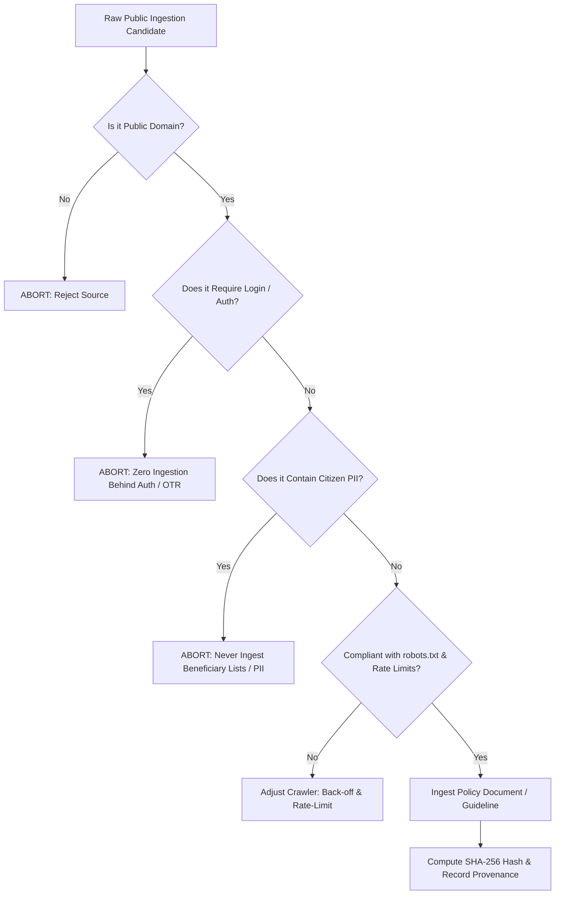
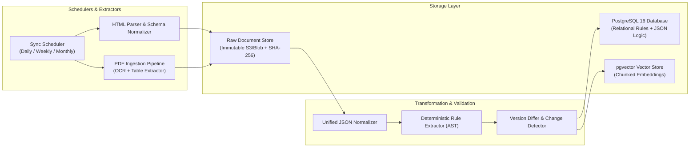

# Source Registry & Data Collection Plan: SchemeSaathi

**Document Version:** 1.0.0  
**Status:** Milestone M0 Baseline  
**Date of Investigation:** November 2026  
**Compliance Standard:** Ethical Public Ingestion, DPDP Act 2023, IT Act 2000

---

## 1. Official Government Source Registry

SchemeSaathi strictly relies on verified, public-domain official government sources. To prevent misinformation, no data is sourced from unverified third-party blogs or ad-driven aggregators.

### Central Government & Statutory Portals

| Registry ID | Authority / Ministry | Portal Name & Domain | Key Schemes Covered | Update Cadence | Access Method | Robots.txt / Access Controls |
| :--- | :--- | :--- | :--- | :--- | :--- | :--- |
| `SRC-CEN-01` | Ministry of Electronics & IT / NeGD | **National Scholarship Portal (NSP)**<br/>`scholarships.gov.in` | All Centrally Sponsored and Central Sector scholarship schemes | Daily during active cycle (July–Dec); Weekly off-cycle | Public HTML scheme guidelines, PDF circulars | Public pages accessible; strictly no crawling behind student/institute login or OTR auth. |
| `SRC-CEN-02` | Ministry of Electronics & IT / NeGD | **myScheme Portal**<br/>`myscheme.gov.in` | Central & State discovery metadata, eligibility checklists | Bi-weekly | Public Web UI, open search endpoints, API Setu integrations | Public pages permitted; respect `robots.txt` crawl delays (1 sec min). |
| `SRC-CEN-03` | MeitY / NeGD | **UMANG Unified Mobile App**<br/>`web.umang.gov.in` | NSP scheme metadata, eligibility directory | Monthly | Public service directory | Mobile app API endpoints require app-signature; only public portal metadata ingested. |
| `SRC-CEN-04` | Ministry of Tribal Affairs (MoTA) | **DBT Tribal Portal & MoTA Main**<br/>`tribal.nic.in` / `dbttribal.gov.in` | Top Class Education for ST, Pre/Post-Matric ST, National Overseas ST | Monthly; ad-hoc circulars | Public PDF operational guidelines, annual reports | Fully open public sector government site. |
| `SRC-CEN-05` | Ministry of Social Justice & Empowerment (MoSJE) | **MoSJE Portal & PM-YASASVI**<br/>`socialjustice.gov.in` / `dosje.gov.in` | PM-YASASVI (OBC/EBC/DNT), Top Class SC, Pre/Post-Matric SC, NOS SC | Monthly; seasonal notifications | Public PDF policy guidelines | Fully open public sector government site. |
| `SRC-CEN-06` | Ministry of Minority Affairs (MoMA) | **MoMA Portal**<br/>`minorityaffairs.gov.in` | Pre-Matric, Post-Matric, Merit-cum-Means (MCM), Begum Hazrat Mahal | Monthly | Public notifications, annual guidelines | Fully open public sector government site. |
| `SRC-CEN-07` | Ministry of Education (MoE) | **Dept of Higher Education & DSEL**<br/>`education.gov.in` / `dsel.education.gov.in` | PM-USP (CSSS), NMMSS (Classes 9–12) | Quarterly | Public scheme gazettes and circulars | Fully open public sector government site. |
| `SRC-CEN-08` | University Grants Commission (UGC) | **UGC Official Portal**<br/>`ugc.gov.in` | Ishan Uday (NER), PG Rank Holders, Single Girl Child | Bi-weekly | Public notices, gazette circulars | Fully open public sector government site. |
| `SRC-CEN-09` | All India Council for Technical Education (AICTE) | **AICTE Schemes Portal**<br/>`aicte-india.org` | Pragati (Girls), Saksham (PwD), Swanath (Orphans/Shaheed wards) | Monthly | Public policy brochures and notifications | Fully open public sector government site. |
| `SRC-CEN-10` | North Eastern Council (NEC) / MoDoNER | **NEC Secretariat**<br/>`necouncil.gov.in` / `mdoner.gov.in` | Financial Support to NER Students for Higher Professional Courses | Monthly | Public guidelines, annual allocative notices | Fully open public sector government site. |
| `SRC-CEN-11` | DEPwD / MoSJE | **Empowerment of Persons with Disabilities**<br/>`disabilityaffairs.gov.in` | Pre/Post-Matric PwD, Top Class Education PwD | Monthly | Public policy guidelines | Fully open public sector government site. |
| `SRC-CEN-12` | Ministry of Labour & Employment | **Labour Welfare Organisation**<br/>`labour.gov.in` | Financial Assistance for Wards of Beedi/Cine/IOMC/LSDM Workers | Bi-annual | Public guidelines and notices | Fully open public sector government site. |

---

### Manipur State Government Portals

| Registry ID | Department / Directorate | Portal Name & Domain | Key Schemes Covered | Update Cadence | Access Method | Identified Reliability / Gaps |
| :--- | :--- | :--- | :--- | :--- | :--- | :--- |
| `SRC-MN-01` | Department of Tribal Affairs & Hills (TAH) | `tahmanipur.gov.in` | Post-Matric ST Manipur, Pre-Matric ST Manipur, GIA grants | Irregular (Monthly to Bi-monthly) | Static HTML notices, uploaded scanned PDFs | Server downtime frequent during power/telecom cuts; non-OCR scanned PDFs. |
| `SRC-MN-02` | Directorate for Welfare of OBC & SC | `manipurobcsc.mn.gov.in` | Post-Matric OBC, Pre-Matric OBC, Post-Matric SC, Dr. Ambedkar EBC | Irregular (Seasonal notifications) | PDF circulars under "What's New" | Formerly on `.gov.in`, migrated to `mn.gov.in`. Occasional broken links for older guidelines. |
| `SRC-MN-03` | Directorate of University & Higher Education | `highereducationmanipur.gov.in` / `manipur.gov.in` | State Merit Scholarship Manipur, CMCSRS (Displaced Students), Super IAS 500 | Bi-monthly | Public press circulars, PDF order sheets | Scheme rules often embedded inside scanned government executive orders. |
| `SRC-MN-04` | Social Welfare Department, Manipur | `manipur.gov.in` / `socialwelfare.mn.gov.in` | CMST (Chief Ministergi Shotharabasingi Tengbang) PwD Scholarship | Quarterly | Government gazettes and PDF circulars | Manual counter forms historically required; digital tracking minimal. |
| `SRC-MN-05` | Directorate of Minorities Affairs, Manipur | `manipurminority.gov.in` | State Minority Merit awards, remedial coaching grants | Irregular | Public circulars | Periodic downtime; requires fallback caching. |

---

## 2. Ethical Data Collection Principles & Boundary Controls

To maintain the highest engineering and legal standards, SchemeSaathi adheres to strict ingestion policies:



### Core Ingestion Principles:
1. **Zero Access Control Ingestion:**  
   SchemeSaathi **never** scrapes behind student logins, institute dashboards, captcha verifications, or Aadhaar Face RD services. Only publicly listed scheme guidelines, notices, and eligibility rules are ingested.
2. **Absolute PII Exclusion:**  
   State portals frequently publish PDF lists of selected beneficiaries containing names, Aadhaar last-4 digits, bank account fragments, and caste details. SchemeSaathi's ingestion pipeline **automatically drops and quarantines** any document detected as an individual beneficiary disbursement list. Only statutory scheme rules, eligibility bounds, and deadline circulars are parsed.
3. **Robots.txt & Responsible Crawler Governance:**  
   - Default user-agent: `SchemeSaathi-Research-Bot/1.0 (+https://schemesaathi.in/bot)`
   - Mandatory minimum request interval: 2.0 seconds per host.
   - Respect all `Disallow` directives on `scholarships.gov.in`, `myscheme.gov.in`, and state domains.
4. **Data Provenance & Cryptographic Lineage:**  
   Every ingested scheme record must store:
   - `source_url` (canonical HTTPS link)
   - `retrieved_at` (UTC timestamp)
   - `content_sha256` (cryptographic checksum of raw HTML/PDF)
   - `academic_year` (e.g., 2024-25, 2025-26)
   - `issuing_authority` (Ministry/Department)
   - `verification_status` (`OFFICIAL_VERIFIED`, `OFFICIAL_PROVISIONAL`, `REQUIRES_REVALUATION`)

---

## 3. Data Collection Pipeline & Ingestion Architecture



### The Scanned PDF Ingestion Challenge (Crucial for Manipur)
Official notifications from the Government of Manipur are almost universally issued as **scanned photocopies of physical typescript orders** bearing official signatures and rubber stamps. Traditional text extractors (such as `pdfminer` or `PyPDF2`) output empty strings on these documents.

**Our Ingestion Pipeline Solution:**
1. **Pre-processing:** PDF page rendering at 300 DPI, followed by deskewing, binarization (Otsu thresholding), and contrast enhancement.
2. **Layout-Aware OCR:** Using high-accuracy open models (PaddleOCR / Tesseract with Devanagari, Bengali/Manipuri, and English dictionaries).
3. **Table Structure Extraction:** Detecting tabular fee ceilings, income cutoffs, and group-level course maintenance rates using border-line detection and cell boundary mapping.
4. **Human-in-the-Loop Verification Flag:** Any scheme rule parsed from scanned PDFs with an OCR confidence score below 92% is marked `OFFICIAL_PROVISIONAL` until verified by an administrative reviewer.

---

## 4. Standardized Unified Scheme JSON Schema

All ingested schemes are transformed into an immutable, version-controlled JSON schema before entering the database:

```json
{
  "$schema": "https://json-schema.org/draft/2020-12/schema",
  "title": "SchemeDefinition",
  "type": "object",
  "required": [
    "scheme_id",
    "official_code",
    "title",
    "issuing_level",
    "ministry_or_department",
    "canonical_source_url",
    "retrieved_at",
    "content_sha256",
    "academic_year",
    "statutory_eligibility",
    "application_lifecycle",
    "verification_status"
  ],
  "properties": {
    "scheme_id": { "type": "string", "pattern": "^[a-z0-9_-]{8,64}$" },
    "official_code": { "type": "string" },
    "title": {
      "type": "object",
      "required": ["en"],
      "properties": {
        "en": { "type": "string" },
        "hi": { "type": "string" },
        "mni_beng": { "type": "string" },
        "mni_latn": { "type": "string" }
      }
    },
    "issuing_level": { "type": "string", "enum": ["CENTRAL_SECTOR", "CENTRALLY_SPONSORED", "STATE_SECTOR"] },
    "ministry_or_department": { "type": "string" },
    "implementing_agency": { "type": "string" },
    "canonical_source_url": { "type": "string", "format": "uri" },
    "guidelines_document_url": { "type": "string", "format": "uri" },
    "retrieved_at": { "type": "string", "format": "date-time" },
    "content_sha256": { "type": "string", "pattern": "^[a-f0-9]{64}$" },
    "academic_year": { "type": "string", "pattern": "^20[2-3][0-9]-20[2-3][0-9]$" },
    "verification_status": { 
      "type": "string", 
      "enum": ["OFFICIAL_VERIFIED", "OFFICIAL_PROVISIONAL", "REQUIRES_REVALUATION", "DEPRECATED"] 
    },
    "statutory_eligibility": {
      "type": "object",
      "required": ["ast_rules", "income_ceiling_annual_inr", "target_categories"],
      "properties": {
        "domicile_required": { "type": "array", "items": { "type": "string" } },
        "target_categories": { "type": "array", "items": { "type": "string", "enum": ["GENERAL", "SC", "ST", "OBC", "EBC", "DNT", "MINORITY_MUSLIM", "MINORITY_CHRISTIAN", "MINORITY_SIKH", "MINORITY_BUDDHIST", "MINORITY_JAIN", "MINORITY_PARSI", "PWD", "ALL"] } },
        "gender_restriction": { "type": "string", "enum": ["ANY", "FEMALE_ONLY", "MALE_ONLY", "TRANSGENDER_ONLY"] },
        "income_ceiling_annual_inr": { "type": ["number", "null"] },
        "minimum_qualifying_marks_percent": { "type": ["number", "null"] },
        "eligible_course_levels": { "type": "array", "items": { "type": "string", "enum": ["PRE_MATRIC", "SECONDARY", "HIGHER_SECONDARY", "DIPLOMA", "UNDERGRADUATE", "POSTGRADUATE", "MPHIL_PHD", "POST_DOCTORAL"] } },
        "institution_requirements": {
          "type": "object",
          "properties": {
            "mandates_aishe_or_udise": { "type": "boolean" },
            "allowed_institution_types": { "type": "array", "items": { "type": "string" } },
            "permits_distance_learning": { "type": "boolean" }
          }
        },
        "ast_rules": { "type": "object", "description": "Deterministic JSON-Logic expression" }
      }
    },
    "application_lifecycle": {
      "type": "object",
      "required": ["application_portal", "portal_status"],
      "properties": {
        "application_portal": { "type": "string", "enum": ["NSP_2_0", "MYSCHEME", "STATE_DIRECT_PORTAL", "OFFLINE_INSTITUTE"] },
        "portal_url": { "type": "string", "format": "uri" },
        "portal_status": { "type": "string", "enum": ["OPEN", "CLOSED", "UPCOMING", "EXTENDED", "UNKNOWN"] },
        "window_open_date": { "type": ["string", "null"], "format": "date" },
        "window_close_date": { "type": ["string", "null"], "format": "date" },
        "defect_correction_close_date": { "type": ["string", "null"], "format": "date" },
        "institute_verification_close_date": { "type": ["string", "null"], "format": "date" },
        "requires_otr_face_rd": { "type": "boolean" },
        "requires_freeship_card": { "type": "boolean" }
      }
    },
    "benefits_summary": {
      "type": "object",
      "properties": {
        "maintenance_allowance_day_scholar_annual_inr": { "type": ["number", "null"] },
        "maintenance_allowance_hosteller_annual_inr": { "type": ["number", "null"] },
        "tuition_fee_coverage": { "type": "string" },
        "book_and_equipment_grant_inr": { "type": ["number", "null"] },
        "disbursement_frequency": { "type": "string", "enum": ["ANNUAL_LUMPSUM", "MONTHLY_STIPEND", "ONE_TIME_GRANT"] }
      }
    },
    "mandatory_documents": {
      "type": "array",
      "items": {
        "type": "object",
        "required": ["document_type", "issuing_authority", "format"],
        "properties": {
          "document_type": { "type": "string" },
          "issuing_authority": { "type": "string" },
          "format": { "type": "string" },
          "validity_period_months": { "type": ["number", "null"] },
          "critical_notes": { "type": "string" }
        }
      }
    }
  }
}
```

---

## 5. Research Gaps & Statutory Unknowns Marked

During the initial M0 research phase, several unresolved statutory uncertainties were identified across portals:

1. **Academic Session Transition Latency:**  
   As of late 2026, several state scholarship web pages still host 2023–24 or 2024–25 circulars without an explicit sunset declaration or renewal for 2025–26 / 2026–27. In SchemeSaathi, these are categorized as `portal_status: UNKNOWN` with an advisory note to users.
2. **Post-Matric SC/ST Income Ceiling Revision Status:**  
   While MoTA guidelines fix the ST family income ceiling at ₹2.50 Lakh, certain state circulars indicate discussions regarding revisions up to ₹3.00 Lakh. Until a gazette notification is issued, the engine strictly enforces the statutory ₹2,50,000 threshold.
3. **Displaced Students Verification Protocols:**  
   For CMCSRS applicants in Manipur who have lost physical documentation in violence-affected zones, alternative e-verification or relief camp identification protocols are administered on an ad-hoc basis by District Commissioners. Standardizing this into deterministic AST rules requires continuous updates from the Manipur Home Department and DUHE.
