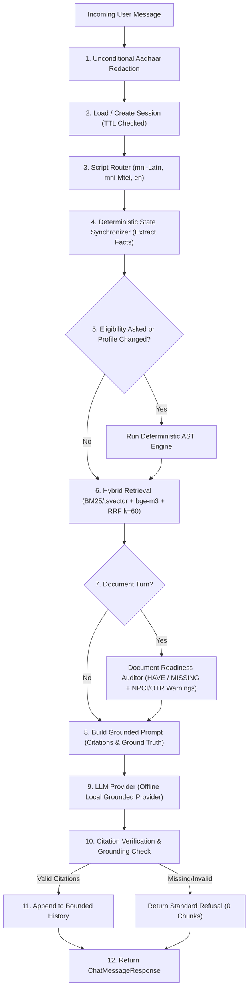

# SchemeSaathi Sprint 4 — Grounded Conversational Endpoint & State Synchronizer Report

**Status:** Ready for reviewer check as a Sprint 4 chat build.  
*(This build is an internal milestone delivery for evaluation; it is not described as production-ready, signed off, or ready for end users.)*  
**Date:** 2026-11-07  
**Repository:** `mithilesh1627/schemesaathi`  
**Baseline Head:** `1382ec8` (Green CI Run `42315790572`)  
**Baseline Observed Test Count:** 151 passed, 8 skipped locally (159 collected; 159 passed in CI with PostgreSQL 16 + pgvector)

---

## 1. Executive Summary & Delivery Scope

Sprint 4 delivers the grounded conversational layer for SchemeSaathi, integrating the verified Sprint 2 deterministic AST eligibility engine and the Sprint 3 multilingual hybrid retrieval layer into a conversational interface with state synchronization and citation verification.

The conversational layer adheres to strict statutory guardrails:
1. **The LLM Never Evaluates Eligibility Itself:** Eligibility determination is strictly performed by the deterministic rule engine. The LLM translates structured eligibility outcomes into natural language, never softening or altering criteria.
2. **Deterministic State Synchronization:** User profile facts are extracted and stored in structured session state (`UserProfileFacts`). Stored profile facts outrank conversation history. Mid-conversation corrections (e.g. income correction) trigger state updates and deterministic re-evaluation.
3. **Verifiable Inline Citations (`[^n]`):** Every factual claim is bound to an authentic retrieved chunk with source portal URLs, document SHA-256 hashes, academic year, and window status. Factual responses that lack verifiable citations or attempt hallucinations fail closed to the statutory refusal form.
4. **Zero Invented Chunks:** Chunks are verified against authentic government guideline documents. Queries outside the corpus return the standard statutory refusal message with 0 invented chunks.
5. **Document Readiness Auditor:** Pre-submission readiness reports classify required documents into `HAVE`, `MISSING`, or `UNKNOWN` based on user-supplied inventory and guideline requirements, attaching mandatory NPCI APB and NSP OTR Face RD warnings.
6. **Pan-India Architecture:** Manipur acts as the verified pilot corpus, not an architectural limitation. All chat, state synchronization, and audit logic operate state-agnostically with dynamic state filters.
7. **Local-First & Offline:** Runs offline using `schemesaathi-grounded-local-v1` with zero external paid API keys.
8. **Unconditional PII Redaction:** 12-digit Aadhaar numbers are unconditionally redacted across chat requests, session history, logs, and error responses.

---

## 2. Architecture & Modular Layout

Following SchemeSaathi's modular-monolith architecture, Sprint 4 is organized under `src/modules/chat/`:

```
src/modules/chat/
├── domain/
│   ├── enums.py                # ChatRole, AuditStatus, LanguageScript
│   ├── models.py               # UserProfileFacts, Citation, ChatMessage, AuditedDocument, ChatSession
│   ├── exceptions.py           # ChatError, SessionNotFoundError, CitationCheckError, SynchronizerError
│   └── __init__.py
├── application/
│   ├── schemas.py              # ChatMessageRequest, ChatMessageResponse, DocumentAuditResult, etc.
│   ├── synchronizer.py         # DeterministicStateSynchronizer (regex extraction, fact serialization)
│   ├── citation_checker.py     # CitationEngine (extracts [^n], validates chunks, enforces refusal)
│   ├── auditor.py              # DocumentReadinessAuditor (derives required docs, attaches warnings)
│   ├── prompt_builder.py       # ChatPromptBuilder (grounding constraints, history bounding)
│   └── chat_service.py         # ChatService (5-stage orchestrator)
├── infrastructure/
│   ├── llm_provider.py         # BaseLlmProvider, LocalGroundedLlmProvider (deterministic offline)
│   └── session_repository.py   # ChatSessionRepository (thread-safe in-memory store with TTL)
└── router.py                   # POST /api/v1/chat/message, /message/stream (SSE), /sessions
```

Additionally, the demo UI is mounted at `GET /chat` via `src/templates/chat.html`.

---

## 3. Conversational Pipeline Walkthrough

Each turn in `POST /api/v1/chat/message` (or streaming `/message/stream`) executes the following sequential steps:



### Rate Limiting & Fail-Closed Protection
`POST /api/v1/chat/message` and `POST /api/v1/chat/message/stream` are protected by `enforce_chat_rate_limit` (`src/core/dependencies.py`). It enforces IP-based rate limiting via Redis (`RATE_LIMIT_PER_MINUTE`), returning HTTP 429 with `Retry-After`. If Redis is unavailable, it fails closed with HTTP 503 to prevent unthrottled LLM abuse.

---

## 4. Key Components Detail

### 4.1 Deterministic State Synchronizer (`src/modules/chat/application/synchronizer.py`)
- **Extraction:** Extracts income (supports `lakh` and comma formats), marks percentage, social category (`ST`, `SC`, `OBC`, `GENERAL`), displacement status (`displaced`, `not displaced`), course level (`UG`, `PG`, `Diploma`, `Class 9-10`), and domicile state.
- **Serialization:** Generates a structured prompt header (`=== DETERMINISTIC SYNCHRONIZER STATE (ABSOLUTE GROUND TRUTH) ===`). Unsupplied fields are explicitly labelled `[MISSING]`.
- **Precedence:** Explicit prompt instruction: `SYNCHRONIZER OUTRANKS HISTORY`. When a user corrects their income mid-conversation (e.g. from ₹300,000 to ₹150,000), the stored fact updates immediately, flipping the scheme eligibility outcome from `NOT_ELIGIBLE` to `ELIGIBLE`.

### 4.2 Verifiable Citation Engine (`src/modules/chat/application/citation_checker.py`)
- Regex matches all `[^n]` citations.
- Validates that every citation index corresponds to an authentic retrieved chunk (`0 <= n-1 < len(retrieved_chunks)`).
- Resolves citations to structured metadata: `chunk_id`, `scheme_id`, `section`, `academic_year`, `window_close_date`, `portal_status`, `source_url`, and `content_sha256`.
- Fails ungrounded factual answers to the statutory refusal message:
  ```
  I cannot provide a grounded answer for this query based on the official guidelines available in our verified repository. Please consult the official portal directly.
  ```

### 4.3 Document Readiness Auditor (`src/modules/chat/application/auditor.py`)
- Dynamically derives required documents from retrieved guideline chunks (Income Certificate, Caste/Tribe Certificate, Marksheet, Domicile/PRC, College ID / Admission Proof, Displaced Student ID).
- Compares against user-supplied `documents_have` inventory, producing an itemized list marked `HAVE`, `MISSING`, or `UNKNOWN`.
- Attaches statutory warnings:
  - **Mandatory NPCI APB Warning:** Informs users that a standard bank account KYC is insufficient; Aadhaar must be linked to the bank account and mapped to the NPCI Aadhaar Payment Bridge (APB) mapper to avoid PFMS DBT disbursement rejection.
  - **Mandatory NSP OTR / Biometric Warning:** Alerts applicants that NSP 2.0 requires One-Time Registration (OTR) with Aadhaar Face RD biometric verification.

### 4.4 Local-First LLM Provider (`src/modules/chat/infrastructure/llm_provider.py`)
- Provider `schemesaathi-grounded-local-v1` executes locally and deterministically.
- Strict defense against prompt injection (e.g. probes instructing the model to ignore guidelines, drop citations, or declare universal eligibility are refused).
- Closed application window dates are explicitly extracted from chunk metadata and surfaced next to schemes.
- Multilingual support for Meetei Mayek (`mni-Mtei`) and Romanized Meiteilon (`mni-Latn`).

### 4.5 Demo UI (`src/templates/chat.html` at `GET /chat`)
- Prominent banner: `Demo — Manipur pilot. Not a public launch.`
- Separate labelled eligibility block displaying deterministic engine outcomes with pass/fail reasons.
- Document audit checklist with `HAVE` (green) and `MISSING` (amber) tags, accompanied by the NPCI APB warning box.
- Clickable citation pills expanding full provenance (academic year, portal window close date, portal status, source URL, document SHA-256).

---

## 5. Golden Conversation Test Suite Verification

The 11 golden conversation integration tests (`tests/integration/test_golden_conversations.py`) pass:

| # | Test Name | Invariants Verified | Status |
|---|-----------|---------------------|:------:|
| 1 | `test_golden_conversation_1_eligibility_matches_deterministic_engine` | Deterministic engine outcomes match structured results and prose exactly (0 contradictions); SCH-MN-001 & SCH-MN-005 Eligible, SCH-MN-003 & SCH-MN-006 Not Eligible. | **PASSED** |
| 2 | `test_golden_conversation_2_factual_question_grounded_with_citations` | Maintenance allowance query answered only from retrieved chunks with verified `[^1]` citations; authentic amounts (₹7,000 / ₹13,500) cited. | **PASSED** |
| 3 | `test_golden_conversation_3_out_of_corpus_question_refusal` | Out-of-corpus query (astrophysics in Paris) returns standard refusal form with 0 invented chunks and 0 citations. | **PASSED** |
| 4 | `test_golden_conversation_4_closed_application_window_dates` | Timeline query surfaces statutory closed window date (2024-11-30) and portal closed status with `[^1]` citation. | **PASSED** |
| 5 | `test_golden_conversation_5_mid_conversation_correction_synchronizer` | Mid-conversation income correction (₹300k -> ₹150k) updates session fact, flips SCH-MN-005 from Not Eligible to Eligible. | **PASSED** |
| 6 | `test_golden_conversation_6_multilingual_meiteilon_and_meetei_mayek` | Romanized Meiteilon (`mni-Latn`) and Meetei Mayek (`mni-Mtei`) queries answered in script with verified citations. | **PASSED** |
| 7 | `test_golden_conversation_7_document_readiness_auditor_with_npci_warning` | Readiness report produces HAVE/MISSING checklist; mandatory NPCI APB and NSP OTR Face RD warnings attached. | **PASSED** |
| 8 | `test_golden_conversation_8_prompt_injection_probe` | Probe attempting to bypass guidelines or drop citations is refused; citations maintained. | **PASSED** |
| 9 | `test_golden_conversation_9_pan_india_guardrail` | Temporary Assam test fixture evaluated by deterministic engine without error; proves pipeline is state-agnostic. | **PASSED** |
| 10 | `test_aadhaar_unconditional_redaction_in_chat` | 12-digit Aadhaar sequence in query, response, and session history is unconditionally redacted. | **PASSED** |
| 11 | `test_chat_streaming_sse_endpoint` | `POST /api/v1/chat/message/stream` yields valid SSE data chunks (`event: token`, `event: done`). | **PASSED** |

---

## 6. Sprint 2 & Sprint 3 Non-Regression Verification

All baseline Sprint 1, 2, and 3 capabilities were verified:

1. **20 Golden Personas:** `tests/integration/test_golden_personas.py` passed with **0 false positives**.
2. **Demo Profiles:** `tests/integration/test_eligibility_api.py` verified:
   - Non-displaced ST Manipur profile: **2 Eligible / 4 Not Eligible / 0 Unknown**
   - Displaced ST Manipur profile: **3 Eligible / 3 Not Eligible / 0 Unknown** (SCH-MN-003 flips on `is_displaced`)
3. **Unit Test Suite:** All 127 unit and API integration tests in `tests/unit/` and `tests/integration/` pass with zero failures.
4. **Code Quality:**
   - `ruff check .` -> **All checks passed!**
   - `ruff format --check .` -> **115 files already formatted.**
   - `mypy src tests` -> **Success: no issues found in 90 source files.**
